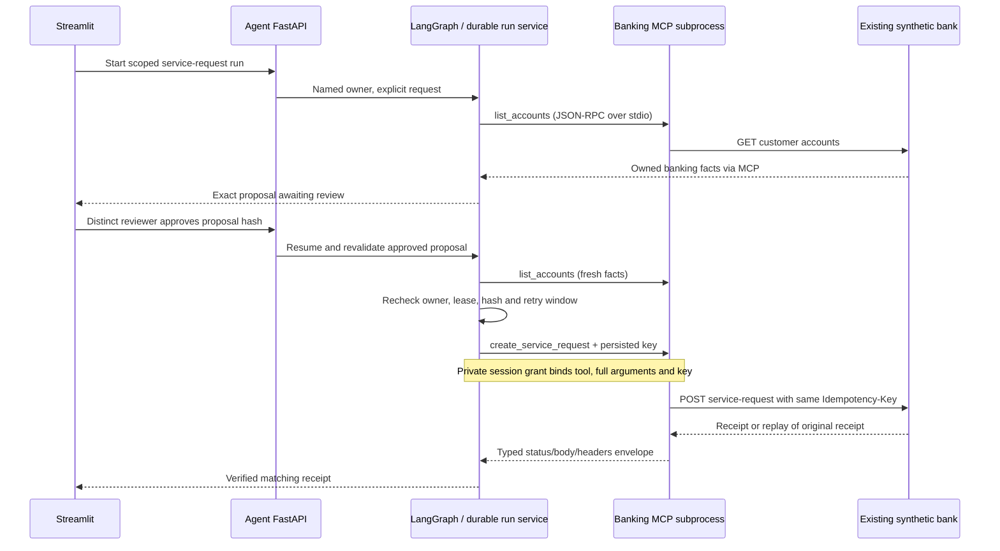

# Banking over MCP

For copy-paste case and service-request payloads, see the [Inspector examples guide](INSPECTOR_EXAMPLES.md) and [complete 22-example JSON catalog](banking_inspector_examples.json).

The Agent uses MCP for banking by default. Streamlit calls Agent FastAPI.
The Validator and Action retain their bounded HTTPX client interface and
validation code. `BankingMCPTransport` sends their calls as typed MCP tools over
stdio or authenticated Streamable HTTP. Only the MCP server connects to the
synthetic bank's REST API in this mode. The existing backend keeps the account,
case, receipt and idempotency state.

The MCP server exposes the current mock banking contract. It adds no core bank
ledger or money-movement operations. The Agent supports five service-request
categories. Trusted integrators can call case tools; autonomous chat actions for
cases remain unavailable.



## Tool inventory

| MCP tool | Existing backend operation |
|---|---|
| `get_customer_profile` | `GET /v1/customers/{id}` |
| `list_accounts` | `GET /v1/customers/{id}/accounts` |
| `get_kyc_status` | `GET /v1/customers/{id}/kyc-status` |
| `get_bureau_summary` | `GET /v1/customers/{id}/bureau-summary` |
| `get_income` | `GET /v1/customers/{id}/income` |
| `list_applications` | `GET /v1/customers/{id}/applications` |
| `list_transactions` | `GET /v1/accounts/{id}/transactions` |
| `get_case` | `GET /v1/cases/{id}` |
| `create_case` | `POST /v1/cases` |
| `add_case_note` | `POST /v1/cases/{id}/notes` |
| `escalate_case` | `POST /v1/cases/{id}/escalations` |
| `create_service_request` | `POST /v1/service-requests` |

There is no arbitrary HTTP, reset, transfer, loan-approval or code-execution tool.
Transaction reads preserve date filters, bounded limit and cursor pagination,
and verify account ownership before reading transactions. Case reads and updates
verify customer ownership. Extra tool fields and invalid IDs are rejected.

## Use HTTP MCP with the web UI

This workspace's private `.env` is configured for:

```dotenv
BANKING_TRANSPORT=mcp
BANKING_MCP_TRANSPORT=http
BANKING_MCP_URL=http://127.0.0.1:9002/mcp
BANKING_MCP_PORT=9002
```

Two distinct private credentials are required: `BANKING_MCP_TOKEN` authenticates
the connection; `BANKING_MCP_SIGNING_KEY` signs short-lived scope/write context.
The two credentials were generated in the ignored `.env`, preserving the other
settings and credentials. Neither is sent to the browser or printed by Make.
For a new environment, provision independent random secrets of at least 32
characters in these two fields. Share only the connection token with trusted
read-only Inspector operators; never share the signing key or backend token.

```sh
make run-http
```

This starts the synthetic bank :8080, RAG :8000, shared banking MCP :9002,
Agent :8001 and Streamlit :8501. Ctrl+C stops only these processes. Existing
processes using these ports must be stopped by their owner before launching.
Open http://localhost:8501 and use **Service requests** with the existing named
owner/reviewer credentials. The UI API contract is unchanged. Browser requests
go to Agent FastAPI; only the server connects to `/mcp`.

If the other services are already running, start just the MCP service with
`make run-banking-mcp`, then restart the Agent so it reads the HTTP settings.
`make run` retains the original four-service launcher and does not start the
shared HTTP MCP service. `make run-http` is the complete HTTP launcher.

`/mcp` is a protocol endpoint, not a browser UI or `/docs`. An unauthenticated
request returns 401. To explore tools in a developer web UI, run
`npx -y @modelcontextprotocol/inspector@2.13.0`, choose Streamable HTTP, enter
`http://127.0.0.1:9002/mcp`, and configure the private connection bearer token.
Token-only sessions are read-only and restricted to the server-configured
`BANKING_MCP_CUSTOMER_IDS` list (empty by default). Do not paste the signing key
or backend credential into Inspector. All twelve tools may be discoverable;
write tools still reject an ungranted call.

### Inspector calls fail

An empty `BANKING_MCP_CUSTOMER_IDS` blocks every customer tool even when the
connection succeeds and all twelve tools are listed. For a read-only session
with the documented synthetic demo customer, configure the server's private
`.env` with:

```dotenv
BANKING_MCP_CUSTOMER_IDS=["NXC-0010"]
```

Choose only customers this Inspector operator may read. Restart the banking MCP
server after changing this setting and reconnect Inspector. If needed, start
the bank with `make run-bank` and the MCP server with `make run-banking-mcp`.
Select `list_accounts` and pass this JSON as its `request` object:

```json
{"customer_id": "NXC-0010"}
```

The complete MCP tool arguments are
`{"request": {"customer_id": "NXC-0010"}}`; the customer ID goes inside
`request`, not at the top level.

| Failure | What to do |
|---|---|
| `Customer access is not authorized` | Configure the permitted customer in `BANKING_MCP_CUSTOMER_IDS` and restart the MCP server. |
| `An exact application-issued write grant is required` | Use Streamlit **Service requests** at `http://localhost:8501`: start as the owner, then approve as a distinct reviewer. |
| Input validation error | Follow the selected tool's nested `request` schema; an operation key for writes must contain 16–64 permitted characters. |
| Connection refused or 401 | Start the MCP server and configure Inspector with the connection bearer token for this server. |

Adding customer read scope does not authorize `create_service_request`,
`create_case`, `add_case_note` or `escalate_case`. The service-request workflow
issues the exact write grant after approval; ordinary Inspector connections
cannot create it. `BANKING_MCP_WRITE_GRANT` configures only a trusted stdio
launcher and does not grant writes to token-only HTTP Inspector sessions.

HTTP checks customer scope and write grants on each request within a bounded
validity window. A grant binds the exact arguments and operation key. The signed
context also binds the backend URL and credential identity. Each caller has
separate request context; the server shares no mutable user scope or grant.
Changing the MCP endpoint, connection/signing credentials or banking backend
blocks existing approved runs rather than silently migrating their writes.
The transport refuses redirects so scoped headers cannot be forwarded elsewhere.

The HTTP listener binds to 127.0.0.1 and is stateless. This is an authenticated
local/private-service integration, not a public OAuth deployment. Keep it behind
trusted networking; add HTTPS and deployment-specific access controls for remote
use. Streamlit users do not receive either internal MCP secret.

## Use stdio instead

Keep the synthetic bank backend running (`make run-bank`) and restart the Agent
with the following setting in its environment or private `.env`:

```dotenv
BANKING_TRANSPORT=mcp
BANKING_MCP_TRANSPORT=stdio
```

This is also the default when unset. `BANKING_API_TOKEN` and named owner/reviewer
configuration remain required. Run `make run-agent` and `make run-ui`, or use the
existing `make run` stack. Do not manually launch the MCP server for Agent calls:
the adapter owns one subprocess per banking call and closes it afterward.

For a callback, use the Streamlit Service requests workspace with customer
`NXC-0010`, an explicit policy date, request type `CALLBACK` and notes. Start the
run as the owner; approve it with a distinct configured reviewer. The same API
request shape is unchanged:

```json
{
  "query": "Prepare a callback service request for this customer.",
  "customer_id": "NXC-0010",
  "as_of": "2026-10-01",
  "action": "createServiceRequest",
  "action_details": {"request_type": "CALLBACK", "notes": "Please arrange a callback."}
}
```

`BANKING_TRANSPORT=http` retains explicit REST compatibility. A saved operation
records its banking transport, destination and credential identity. A transport
change blocks submission or retry instead of moving an approved write.
For runs created before this change, finish/reconcile under `http` before switching.
After an uncertain MCP write, the adapter neither falls back nor retries
automatically. Load or retry the original saved run with its original operation key.

## Trust boundary and errors

The standalone MCP server is read-only unless its trusted launcher provides an
exact write grant. For read-only Inspector use, set `BANKING_MCP_CUSTOMER_IDS` to
a JSON list of permitted synthetic customer IDs, then launch
`python -m app.mcp.banking_server` through an MCP client. Scope is trusted session
configuration, never a tool argument. Empty scope allows no customer reads.

The application transport issues an operation digest only when trusted service
code actually submits a write. This digest binds arguments; it is not a user
credential or a replacement for human approval. Tool arguments cannot supply a
grant or `approved=true`. Do not expose the internal HTTPX client or grant-issuing
transport to a model or untrusted caller. Existing durable-run checks remain the
approval authority; the explicitly enabled legacy submission setting retains its
existing compatibility behavior. All writes are unavailable to ordinary external
MCP clients. Local process owners who can read `.env` remain trusted operators.

The subprocess receives only backend credentials, URL, deadline, customer scope
and the single-operation digest. Do not store runtime grants in a client config or report. Stdout carries the
MCP protocol; logs go to stderr. The deadline covers connection, discovery and
execution. The adapter does not retry, and a timeout does not prove that the bank
failed to commit the write. The response envelope retains status codes, ETag,
replay and Retry-After metadata, while masking upstream diagnostic bodies.
Receipt schema, customer/type/loan identity and existing exact proposal checks
remain enforced. MCP annotations describe behavior; they do not authorize it.

This is trusted local stdio. Public OAuth, remote deployment hardening, durable
bank backend storage and autonomous case workflows require separate work.

## Code map and verification

| File | Responsibility |
|---|---|
| `app/api/dependencies.py` | Resolves named scope and selects the MCP transport by default |
| `app/services/banking_mcp.py` | Fixed path-to-tool mapping, canonical write grant, owned subprocess, discovery allowlist, deadlines and safe failures |
| `app/mcp/banking_http.py` | Authenticates HTTP, verifies signed scope/grants and backend identity per request |
| `app/models/banking_mcp.py` | Strict tool arguments, status envelope and canonical operation binding |
| `app/mcp/banking_server.py` | Registers twelve tools; enforces session scope, ownership and exact grants; calls existing bank backend |
| `app/services/validation.py` | Existing dated-policy and current-account eligibility checks |
| `app/services/service_requests.py` | Existing exact proposal and matching receipt checks |
| `app/services/agent_runs.py` | Existing owner/reviewer approval, leases, transport identity and same-key recovery |
| `tests/test_banking_mcp.py` | Protocol, all tools, scope, grants, ownership, replay, errors and adapter boundaries |
| `tests/test_agent_runs.py` | Same full workflow suite over both HTTP and MCP, including five request types and uncertain writes |

Run `make check-task` and the security scan from `make check-full`. Protocol tests
use the real FastMCP in-process transport with a synthetic bank and fake models;
no provider/Atlas calls or real customer records are needed. Streamlit AppTest
exercises owner/reviewer flows through the actual graph in both modes.

References: [FastMCP transports](https://gofastmcp.com/clients/transports),
[FastMCP tools](https://gofastmcp.com/servers/tools).
