# NexaAssist architecture map

Source snapshot: **19 November 2026**, the running `Week_1_code` checkout on `feat/prepayment-validator` at `bc87167`, including its existing uncommitted work. The companion `nexa-banking-mcp` checkout is on `codex/claude-user-approved-writes` at `3fb1a35`, also with uncommitted work. This guide describes that source; the separate `codex/production-hardening` worktree contains different implementation work.

Open the [visual architecture viewer](index.html#architecture) for rendered diagrams and expandable Mermaid source. Every diagram below is editable Mermaid; the numbered SVG links provide exportable copies. Start with the [overall application map](#22-overall), then follow the service maps and workflows for detail.

The reviewed deployed profile selects **policy MCP retrieval**, **banking MCP over HTTP with Horizon OAuth**, **MongoDB staff credentials**, **dense retrieval**, and **reranking disabled**. Configuration values are described without credentials. Remote deployment URLs were supplied by the operator; this documentation task did not inspect live deployment images or prove they match either dirty checkout.

## Service inventory

| Component | Entry point / boundary | Responsibility and authentication |
| --- | --- | --- |
| Streamlit | `app/streamlit_app.py`, local `:8501` | Rendering and browser-session state; named Agent credential for banking |
| Agent FastAPI | `app/agent_main.py`, local `:8001` | Routing, current staff grants, saved runs, distinct approval and bank orchestration |
| RAG FastAPI | `app/main.py`, local `:8000` | Retrieval, cited answering, quality and feedback; policy routes currently public |
| Policy MCP | `app/mcp/server.py`, owned stdio child | Read-only retrieval wrapper around RAG HTTP |
| Banking MCP | `app/mcp/banking_server.py`; companion hosted entry `app/mcp/horizon.py` | Twelve tools; customer scope, ownership and exact write grants; Horizon OAuth plus signed context |
| Banking API | Companion `app/banking_main.py`, [Render HTTPS](https://nexa-banking-api.onrender.com) | Backend service bearer; fixtures for customer reads, transactional MongoDB write state |
| Local mock bank | `nexa_synthetic_data/api/mock_server/server.py`, `:8080` | Separate synthetic test double; process-local write state |
| Application Atlas | `app/database/` | Vector search, full parents, feedback, staff grants and durable run/checkpoint data |
| Banking MongoDB | Companion `app/database/banking.py` | Atomic bank mutations and replay records; no Atlas access needed by Horizon MCP itself |
| Model APIs | `app/chains/llm.py`, `app/chains/embeddings.py` | Configured embedding, generation, classification and evaluation clients |
| Optional reranker | `app/compose.reranker.yaml`, local `:18516` | Configured rerank stage, inactive in selected profile |
| Datadog | `app/core/telemetry.py`, optional local Agent | APM, LLM observations and scores when enabled; JSON stdout needs separate log shipping |
| Offline commands / CI | Ingestion, staff import, evaluation and quality workflows | Administrative and verification operations; not additional web services |

## Reading the maps

- Solid arrows are calls or data flow; dashed arrows are optional/configured alternatives or qualified relationships. They do not imply automatic failover.
- Boxes inside one API boundary are logical modules, not separately deployed microservices. MongoDB boxes denote logical ownership, not separate clusters or foreign keys.
- Returned banking receipts mean acceptance; they do not prove that every requested downstream service has completed.
- Implementation paths below each diagram refer to the reviewed local checkout and its sibling banking repository. Application source files are excluded from this static site.

## Diagram index

1. [Runtime profiles and process boundaries](#01-profiles)
2. [Streamlit UI service](#02-streamlit)
3. [Agent API service](#03-agent-api)
4. [RAG API service](#04-rag-api)
5. [Policy MCP service](#05-policy-mcp)
6. [Banking MCP service and trust boundaries](#06-banking-mcp)
7. [Banking API service: persistent deployment and local mock](#07-banking-api)
8. [Data ownership and retention](#08-data)
9. [Model APIs and optional reranking service](#09-models)
10. [Observability service and export paths](#10-telemetry)
11. [Workflow: staff login and independent service authentication](#11-authentication)
12. [Workflow: policy retrieval and validated answering](#12-policy-answer)
13. [Workflow: evidence expansion and citation gate](#13-retrieval)
14. [Workflow: complete LangGraph routing](#14-langgraph)
15. [Workflow: accounts, income and bounded transactions](#15-customer-reads)
16. [Workflow: supported banking actions and validation](#16-action-validation)
17. [Workflow: distinct approval, execution and ambiguous recovery](#17-approval)
18. [Workflow: observed saved-run lifecycle](#18-lifecycle)
19. [Workflow: authoritative policy ingestion and retirement](#19-ingestion)
20. [Workflow: feedback persistence and review](#20-feedback)
21. [Workflow: quality evaluation and CI gates](#21-evaluation)
22. [Overall: entire NexaAssist application](#22-overall)

<a id="01-profiles"></a>

## 01-profiles: Runtime profiles and process boundaries

The selected .env.deployed profile runs the UI, Agent API and RAG API locally. Banking calls cross HTTPS to Horizon and Render. Solid edges show that profile; dashed edges show explicitly configured alternatives, never automatic failover. Ports are local defaults.

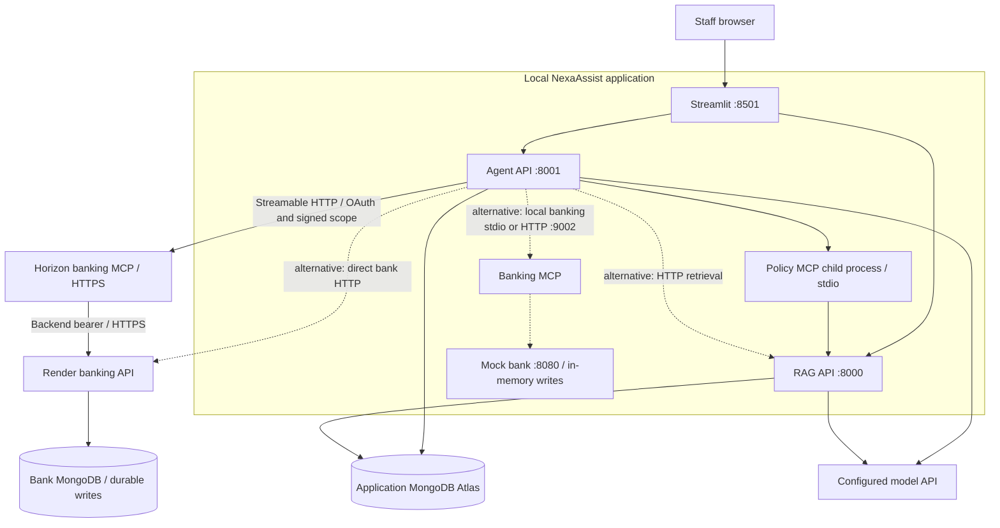

[Export SVG](map-1.svg). Sources: `Makefile`, `app/api/dependencies.py`, `app/services/agent.py`, `app/mcp/BANKING.md`, `nexa-banking-mcp/render.yaml`.

<a id="02-streamlit"></a>

## 02-streamlit: Streamlit UI service

Streamlit renders API results and keeps browser-session state. Normal reruns retain chat and login; hard refreshes or a process restart may reset that state. Durable runs live in MongoDB. Reviewer credentials are submitted for the explicit approval request; the owner login remains separate.

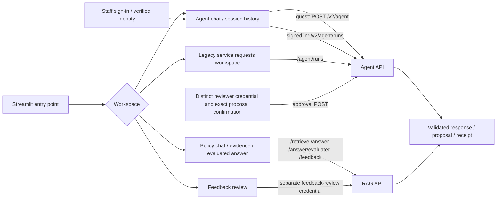

[Export SVG](map-2.svg). Sources: `app/streamlit_app.py`, `app/ui/app.py`, `app/ui/agent.py`.

<a id="03-agent-api"></a>

## 03-agent-api: Agent API service

Thin routers resolve server-managed access and call services. Public agent endpoints can handle policy and clarification requests; named access is required for saved banking runs. Agent policy answers use the local answer chain with remotely retrieved evidence, rather than calling the RAG answer endpoint.

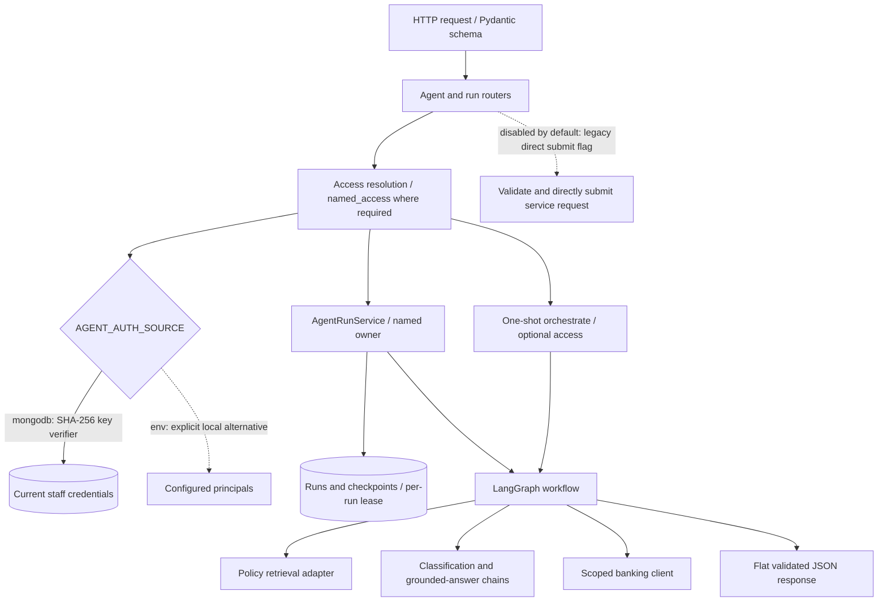

[Export SVG](map-3.svg). Sources: `app/agent_main.py`, `app/api/agent.py`, `app/api/agent_runs.py`, `app/api/auth.py`, `app/services/agent.py`, `app/services/agent_runs.py`.

<a id="04-rag-api"></a>

## 04-rag-api: RAG API service

The running checkout exposes retrieval and answer routes without staff OIDC or per-document ACL middleware. Corpus metadata filters constrain policy scope; they are not identity authorization. Health is liveness. This checkout has no RAG /ready or /answer/stream endpoint.

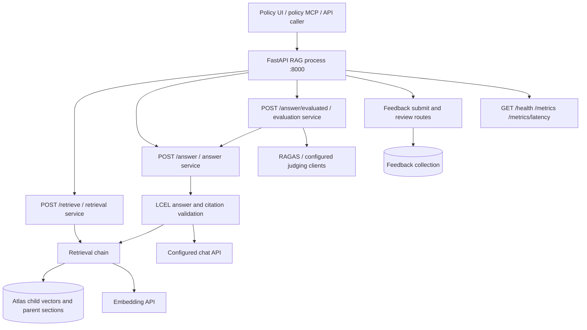

[Export SVG](map-4.svg). Sources: `app/main.py`, `app/core/lifespan.py`, `app/api/retrieval.py`, `app/api/answer.py`, `app/api/feedback.py`, `app/api/operations.py`, `app/services/answer.py`.

<a id="05-policy-mcp"></a>

## 05-policy-mcp: Policy MCP service

This read-only stdio child wraps the RAG retrieval API. The client discovers the expected tool, validates its result and resolved scope, then stops on failure. HTTP retrieval is a configuration alternative, not a runtime fallback. No banking tools or direct Atlas client live here.

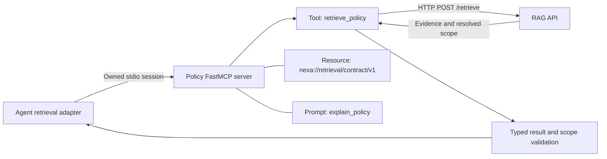

[Export SVG](map-5.svg). Sources: `app/mcp/server.py`, `app/services/agent_mcp_retrieval.py`, `app/services/agent_retrieval.py`, `app/chains/prompts/mcp.py`.

<a id="06-banking-mcp"></a>

## 06-banking-mcp: Banking MCP service and trust boundaries

The application adapter exposes a fixed twelve-tool contract. Hosted calls require both Horizon OAuth and an application-signed context. The context binds customer scope, principal, backend identity and an optional exact write grant. Gateway login alone does not confer write authority. Local stdio and local HTTP are separately configured transports.

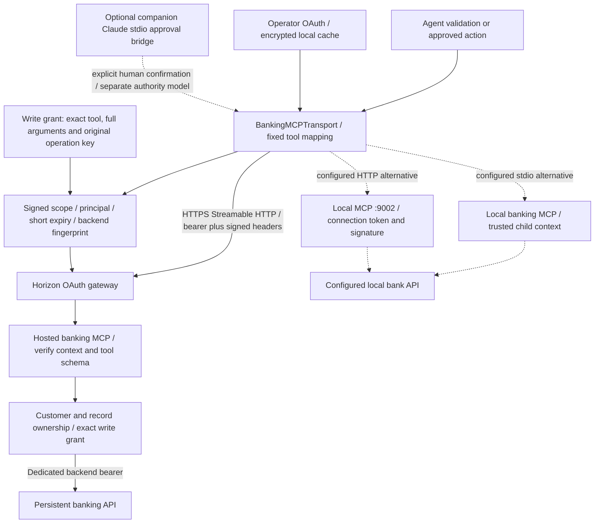

[Export SVG](map-6.svg). Sources: `app/services/banking_mcp.py`, `app/models/banking_mcp.py`, `app/mcp/banking_server.py`, `app/mcp/banking_http.py`, `app/services/banking_mcp.py`, `app/mcp/horizon_login.py`, `nexa-banking-mcp/app/mcp/horizon.py`, `nexa-banking-mcp/app/mcp/claude_approved.py`.

<a id="07-banking-api"></a>

## 07-banking-api: Banking API service: persistent deployment and local mock

The companion source supplies the Render service: authenticated /v1 routes, fixture-based customer reads, and transactional MongoDB write state. Its shared backend token is a service credential, not an end-user entitlement. Customer ownership and reviewer authorization therefore belong upstream. The main-repository mock is a separate in-memory test double.

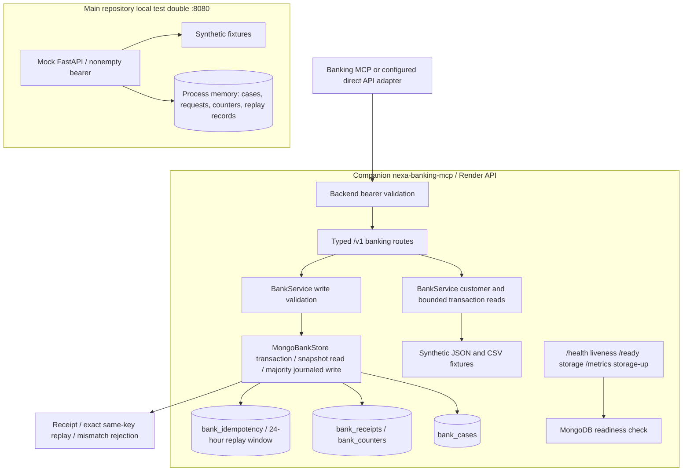

[Export SVG](map-7.svg). Sources: `nexa-banking-mcp/app/banking_main.py`, `nexa-banking-mcp/app/api/banking.py`, `nexa-banking-mcp/app/services/banking.py`, `nexa-banking-mcp/app/database/banking.py`, `nexa-banking-mcp/render.yaml`, `nexa_synthetic_data/api/mock_server/server.py`.

<a id="08-data"></a>

## 08-data: Data ownership and retention

Names below are configuration defaults or companion collection names, not a claim about private active database names. The application and bank have distinct logical storage responsibilities; they may share an Atlas cluster. Arrows mean application access, not enforced foreign keys. Checkpoint internals remain library-managed.

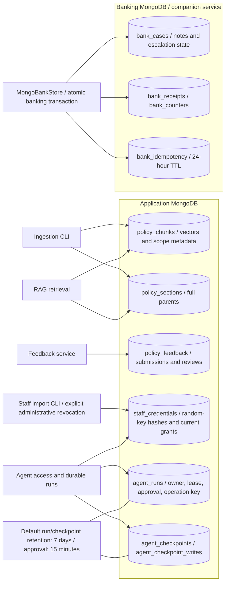

[Export SVG](map-8.svg). Sources: `app/core/config.py`, `app/database/mongo.py`, `app/database/agent_runs.py`, `app/database/staff_credentials.py`, `app/database/feedback.py`, `nexa-banking-mcp/app/database/banking.py`.

<a id="09-models"></a>

## 09-models: Model APIs and optional reranking service

Model identifiers and endpoints come from settings. Agent classification and policy answering both use configured model clients. Retrieval calls embeddings; evaluation may call a judge. Dense retrieval with reranking disabled is the selected profile. The optional llama.cpp container is a reranking service, not the main generation backend.

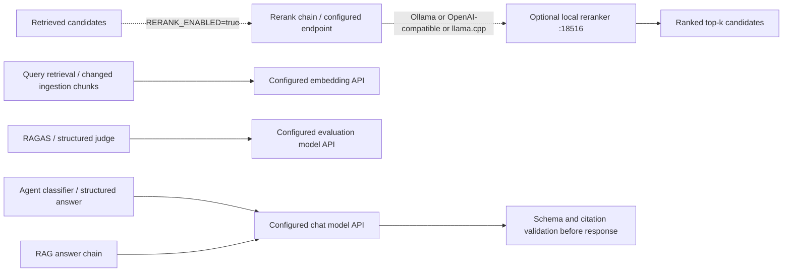

[Export SVG](map-9.svg). Sources: `app/chains/llm.py`, `app/chains/embeddings.py`, `app/chains/rerank.py`, `app/compose.reranker.yaml`, `app/evaluation/ragas_metrics.py`.

<a id="10-telemetry"></a>

## 10-telemetry: Observability service and export paths

Startup configures structured JSON logs and optional ddtrace instrumentation. A local Datadog Agent can forward APM and runtime metrics; LLM Observability and evaluation/feedback exports are separately configured. This source still contains content-bearing annotations. The map does not claim production redaction or verified cloud receipt.

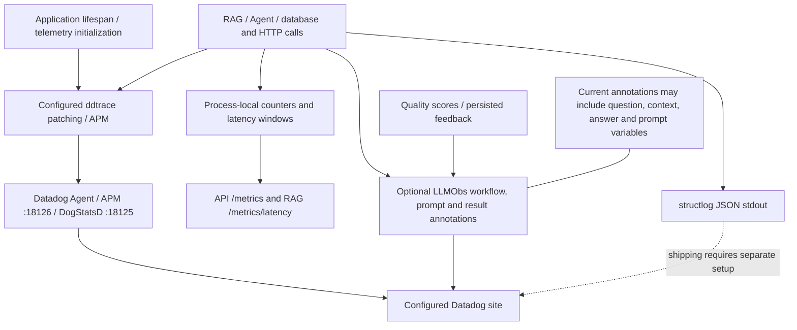

[Export SVG](map-10.svg). Sources: `app/core/lifespan.py`, `app/core/logging.py`, `app/core/telemetry.py`, `app/core/observability.py`, `app/compose.datadog.yaml`.

<a id="11-authentication"></a>

## 11-authentication: Workflow: staff login and independent service authentication

This is named API-key login, not staff OIDC. In MongoDB mode, a disabled key or unavailable grant store never falls back to environment grants. Horizon consent is an operator setup step; backend secrets are not entered into Streamlit chat.

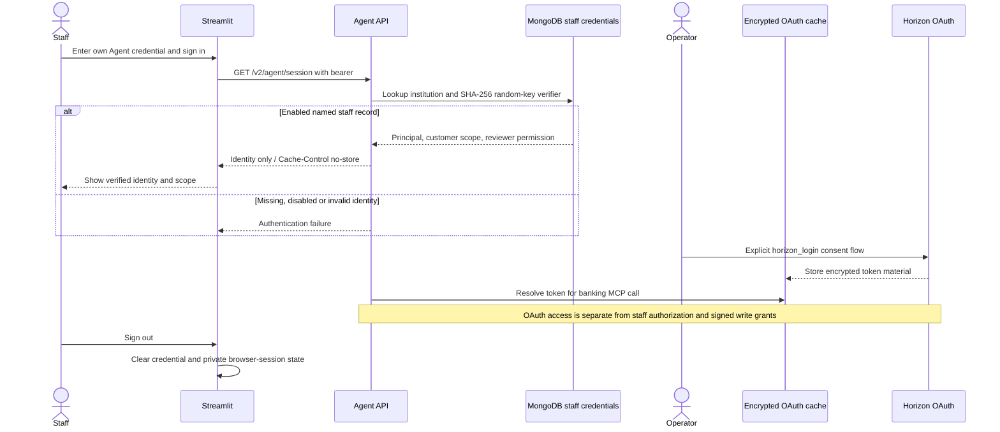

[Export SVG](map-11.svg). Sources: `app/api/auth.py`, `app/database/staff_credentials.py`, `app/ui/agent.py`, `app/mcp/horizon_login.py`, `app/services/banking_mcp.py`.

<a id="12-policy-answer"></a>

## 12-policy-answer: Workflow: policy retrieval and validated answering

There are two answer entry paths. Agent chat classifies first and retrieves over policy MCP in the selected profile, then generates inside Agent. Policy chat calls the RAG answer service directly. Neither path streams draft answer tokens in this checkout.

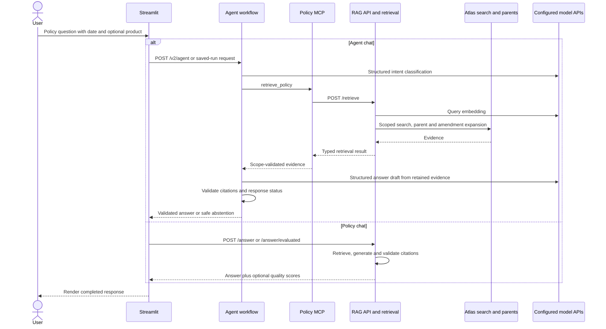

[Export SVG](map-12.svg). Sources: `app/services/agent.py`, `app/services/agent_mcp_retrieval.py`, `app/services/answer.py`, `app/chains/answer.py`, `app/ui/app.py`.

<a id="13-retrieval"></a>

## 13-retrieval: Workflow: evidence expansion and citation gate

The scope filters institution, jurisdiction, confidentiality, effective dates and optional product. These are corpus filters, not per-user ACLs. Parent mismatch can fall back to the child. Amendment completeness is checked; if context assembly omits a required amendment the answer chain abstains before generation.

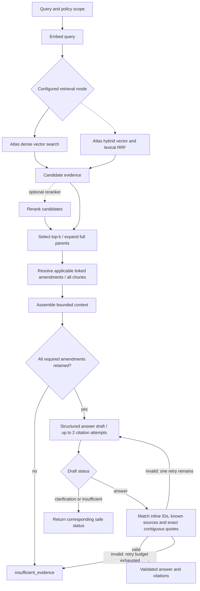

[Export SVG](map-13.svg). Sources: `app/chains/retrieval.py`, `app/database/retrieval.py`, `app/chains/context.py`, `app/chains/answer.py`.

<a id="14-langgraph"></a>

## 14-langgraph: Workflow: complete LangGraph routing

Node names match build_agent_graph. Guardrails screen inputs before routing/model or tool work. The approval node interrupts a durable run; only an approved exact proposal proceeds to refreshed validation. A one-shot workflow without an actioner cannot execute a write.

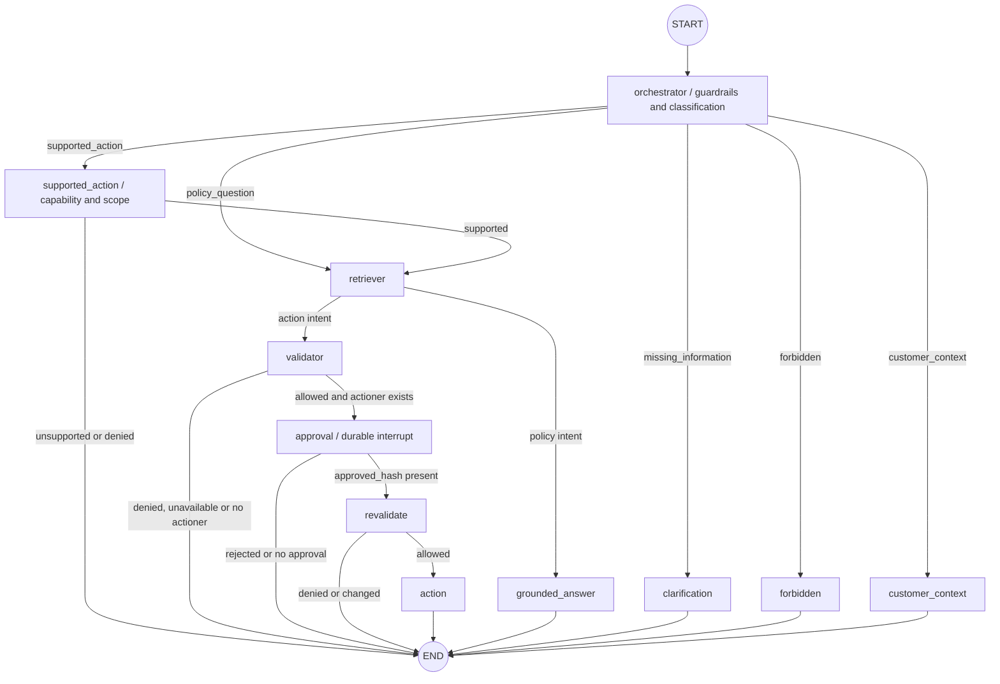

[Export SVG](map-14.svg). Sources: `app/agents/orchestrator.py`, `app/agents/guardrails.py`, `app/services/agent.py`, `app/services/agent_runs.py`.

<a id="15-customer-reads"></a>

## 15-customer-reads: Workflow: accounts, income and bounded transactions

Only accounts/loans, disclosed income with verification status, and bounded owned-account transactions are connected to Agent chat. Other customer MCP tools are not automatically available through chat. These reads do not create proposals or banking mutations. The UI session requires named staff; an explicitly configured legacy environment token can still authorize scoped one-shot API reads, but not durable approval runs.

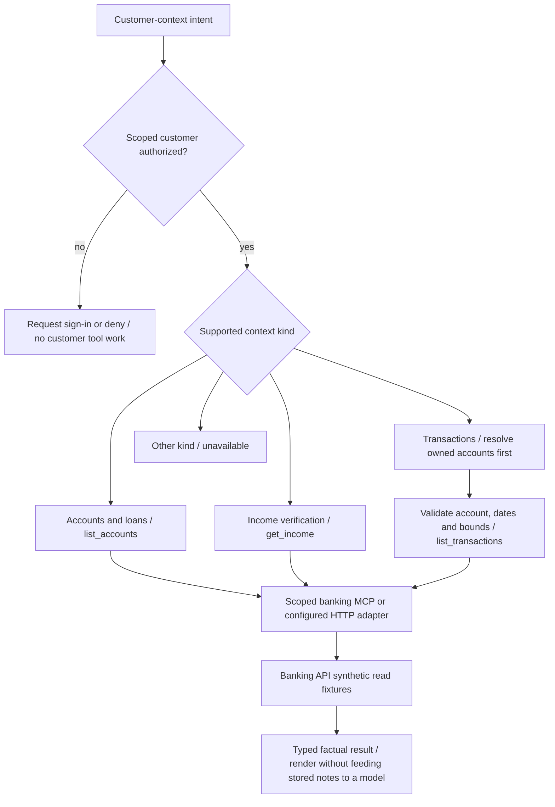

[Export SVG](map-15.svg). Sources: `app/services/customer_context.py`, `app/services/transactions.py`, `app/agents/orchestrator.py`, `app/services/banking_mcp.py`.

<a id="16-action-validation"></a>

## 16-action-validation: Workflow: supported banking actions and validation

Scope and exact structured details are validated in services. Case notes are stored as notes; they do not change priority, escalate the case or promise an SLA. escalate_case is an MCP capability but is not connected to Agent chat.

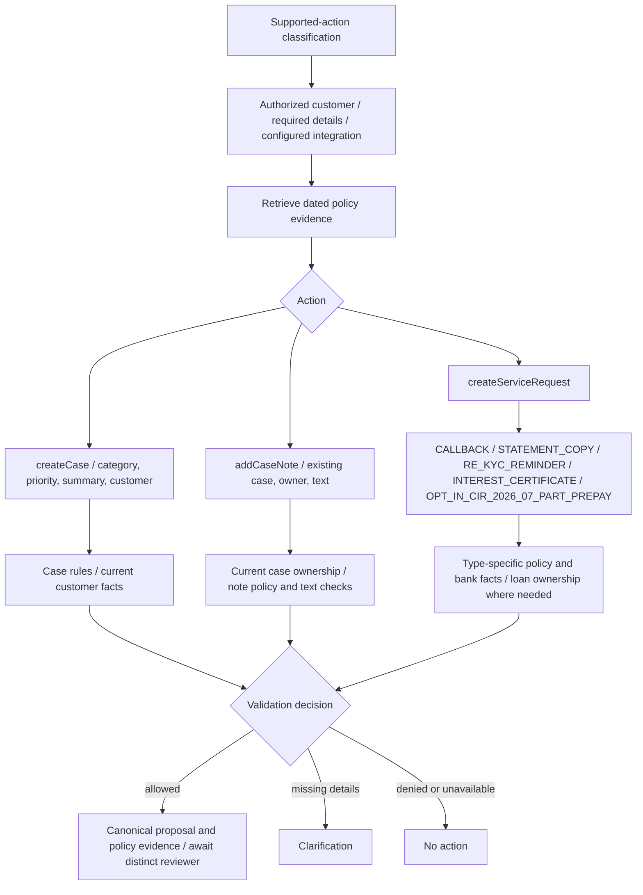

[Export SVG](map-16.svg). Sources: `app/services/cases.py`, `app/services/validation.py`, `app/services/service_requests.py`, `app/models/validation.py`, `app/agents/orchestrator.py`.

<a id="17-approval"></a>

## 17-approval: Workflow: distinct approval, execution and ambiguous recovery

The run retains one operation key and exact proposal hash. Current owner/reviewer grants and bank destination are rechecked before effects. The 23-hour application retry boundary is shorter than the bank replay window. Operational checkpoints are not an independent long-retention action audit.

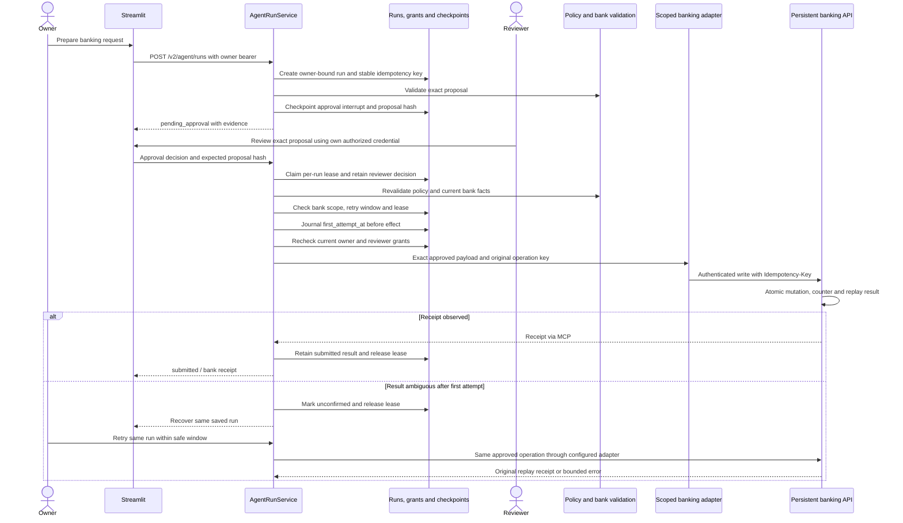

[Export SVG](map-17.svg). Sources: `app/services/agent_runs.py`, `app/database/agent_runs.py`, `app/models/agent_run.py`, `app/models/banking_mcp.py`, `nexa-banking-mcp/app/database/banking.py`.

<a id="18-lifecycle"></a>

## 18-lifecycle: Workflow: observed saved-run lifecycle

This is a conceptual view derived from run metadata and graph checkpoints, not a promise that every label is a stored status enum. Leases serialize one run, not all institution traffic. Finalization releases the lease on completion or failure. Expired or changed proposals cannot be treated as fresh approvals.

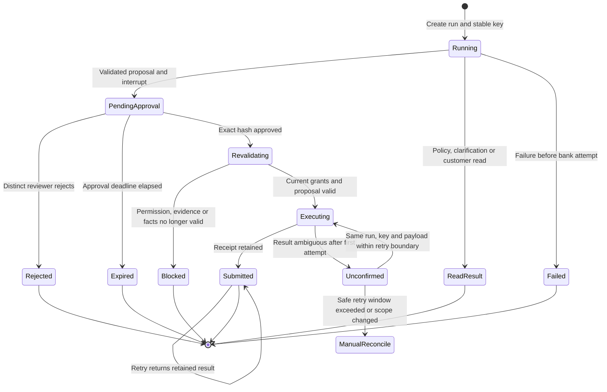

[Export SVG](map-18.svg). Sources: `app/services/agent_runs.py`, `app/models/agent_run.py`, `app/database/agent_runs.py`.

<a id="19-ingestion"></a>

## 19-ingestion: Workflow: authoritative policy ingestion and retirement

The document register defines authority. Existing ingestion updates child and parent collections in place, not as an immutable paired generation. A failure can therefore leave partial cross-collection changes. Retirement physically removes scoped documents and has no revocation tombstones.

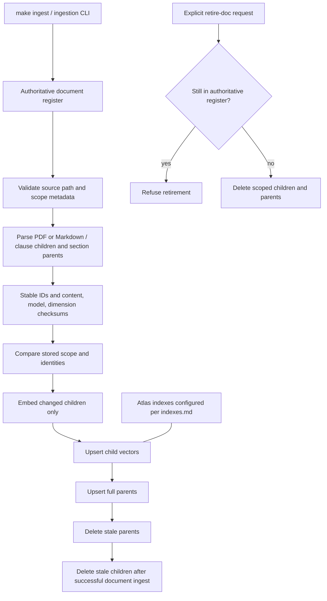

[Export SVG](map-19.svg). Sources: `app/services/ingestion.py`, `app/chains/ingestion.py`, `app/chains/parsing.py`, `app/chains/chunking.py`, `app/database/indexes.md`, `nexa_synthetic_data/document_register.json`.

<a id="20-feedback"></a>

## 20-feedback: Workflow: feedback persistence and review

Feedback identity currently derives from a UI submitter UUID and submission UUID, not verified staff ownership. Identical resubmission is idempotent; changed content under the same identity conflicts. Listing and review use a separate shared feedback-review credential. Database persistence precedes optional telemetry export.

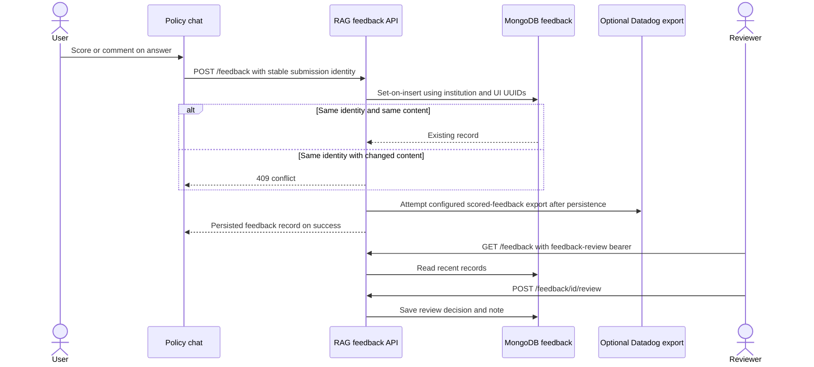

[Export SVG](map-20.svg). Sources: `app/ui/app.py`, `app/api/feedback.py`, `app/services/feedback.py`, `app/database/feedback.py`.

<a id="21-evaluation"></a>

## 21-evaluation: Workflow: quality evaluation and CI gates

Quality checks and live model evaluation are separate. PR/push CI runs source quality plus MongoDB workflow and supplied mock-bank tests. The trusted live workflow is manual or callable; this branch does not implement automatic release-bundle promotion or rollback. Synthetic fixtures do not establish production representativeness.

```mermaid
flowchart TB
  CHANGE["PR or push"] --> CI["Quality workflow / make check-full"]
  CI --> FLOOR["Floor guard / Ruff / formatting / mypy"]
  CI --> TEST["pytest / application coverage at least 84.13 percent / changed app lines 100 percent"]
  CI --> SEC["Source and secret scans / no new security fingerprints"]
  CI --> INT["MongoDB durable-workflow tests / supplied mock-bank contract tests"]
  TRUST["Manual or callable trusted ai-evaluation workflow"] --> LIVE["make check-ai / complete retained golden dataset"]
  GOLD["Local golden cases and unchanged protocol / baseline fingerprints"] --> LIVE
  LIVE --> CALLS["Configured Atlas, embeddings, generation and judges"]
  CALLS --> MET["RAGAS metrics and structured judge scores"]
  MET --> GATE["phase_gate / expected statuses, finite scores and retained metric floors"]
  GATE --> REPORT["Passing evidence or explicit gate failure"]
  DIRECT["POST /answer/evaluated"] --> ONCE["Generate once / retain evidence / score requested metrics"]
  ONCE --> RESULTS["Answer and per-metric status / optional Datadog export"]
  REPORT -. "deployment and promotion remain separate" .-> RELEASE["Operator release decision"]
```

[Export SVG](map-21.svg). Sources: `.github/workflows/quality.yml`, `.github/workflows/ai-evaluation.yml`, `CONSTRAINTS.md`, `app/evaluation/run.py`, `app/evaluation/phase_gate.py`, `app/services/evaluation.py`.

<a id="22-overall"></a>

## 22-overall: Overall: entire NexaAssist application

This final map combines the deployed-banking profile, application layers, shared dependencies and offline operations. Dashed components are optional or alternative. Application MongoDB and banking MongoDB are separate logical stores. The boundaries shown are those implemented by the reviewed source, not a claim that the production-hardening plan is complete.

```mermaid
flowchart TB
  STAFF["Staff and distinct reviewer"] --> UI["Streamlit :8501"]
  subgraph LOCAL["Local NexaAssist application"]
    UI --> A["Agent API :8001"]
    UI --> R["RAG API :8000"]
    A -->|"Policy evidence"| PM["Policy MCP / stdio"]
    PM --> R
    A --- G["LangGraph / durable runs / separate review"]
    ING["Ingestion CLI"]
    EV["Evaluation CLI and quality gates"]
  end
  subgraph BANKING["Deployed synthetic banking services"]
    H["Horizon / banking MCP"] -->|"Backend bearer"| BANK["Render / banking API"]
    BANK --> FIX["Synthetic read fixtures"]
    BANK --> BD[("Bank MongoDB / cases and replay records")]
  end
  A -->|"OAuth / signed customer scope and exact write grant"| H
  A --> AD[("Application Atlas / staff, runs and checkpoints")]
  R --> PD[("Application Atlas / policy vectors, parents and feedback")]
  ING --> PD
  A --> MODEL["Configured model APIs"]
  R --> MODEL
  ING --> MODEL
  EV --> R
  EV --> MODEL
  R -. "optional" .-> RR["Reranker"]
  A -. "configured local alternative" .-> MOCK["Local banking MCP / mock API"]
  A -. "configured telemetry" .-> DD["Datadog / APM and LLM observations"]
  R -.-> DD
  classDef ui fill:#e6f4f1,stroke:#247d71,color:#123d36
  classDef api fill:#e9effa,stroke:#426da4,color:#1a3555
  classDef store fill:#fff5df,stroke:#ab8437,color:#584316
  classDef external fill:#f3eefa,stroke:#8762a4,color:#492b61
  class UI ui
  class A,R,PM,G api
  class AD,PD,BD store
  class H,BANK,MODEL,DD external
```

[Export SVG](map-22.svg). Sources: `app/ui/app.py`, `app/agent_main.py`, `app/main.py`, `app/services/agent.py`, `app/agents/orchestrator.py`, `app/services/agent_runs.py`, `app/chains/retrieval.py`, `app/mcp/server.py`, `app/mcp/banking_server.py`, `nexa-banking-mcp/app/mcp/horizon.py`, `nexa-banking-mcp/app/banking_main.py`, `nexa-banking-mcp/app/database/banking.py`.

## Current interface and capability boundaries

| Interface | Routes or tools | Current boundary |
| --- | --- | --- |
| RAG HTTP | `POST /retrieve`, `/answer`, `/answer/evaluated`; `GET /health`, `/metrics`, `/metrics/latency` | No staff SSO or per-user document ACL gate on these routes in this checkout |
| Feedback | `POST /feedback`; reviewer-protected `GET /feedback`, `POST /feedback/{feedback_id}/review` | Submission uses UI UUID identity; reviews use a separate shared credential |
| Agent HTTP | `POST /agent`, `/v2/agent`; `GET /v2/agent/session`; `GET /health`, `/metrics` | Session verifies a named identity; public one-shot routing does not grant bank access |
| Saved runs | `POST /agent/runs` and `/v2/agent/runs`; matching `GET /{run_id}`, `POST /{run_id}/approval`, `POST /{run_id}/retry` | Owner scope; distinct authorized reviewer for exact proposal; invisible runs return 404 |
| Legacy submit | `POST /agent/submit` | Disabled by default through `AGENT_ALLOW_DIRECT_SUBMIT`; enabling it bypasses durable separate-review flow |
| Policy MCP | `retrieve_policy`; resource `nexa://retrieval/contract/v1`; prompt `explain_policy` | Read-only RAG wrapper |
| Banking read tools | `get_customer_profile`, `list_accounts`, `get_kyc_status`, `get_bureau_summary`, `get_income`, `list_applications`, `list_transactions`, `get_case` | MCP exposure is broader than Agent chat support |
| Banking write tools | `create_case`, `add_case_note`, `escalate_case`, `create_service_request` | Agent chat connects cases, notes and five service-request types; escalation is not connected there |
| Banking HTTP | `/v1/customers/{customerId}` with accounts/income/bureau-summary/kyc-status/applications; `/v1/accounts/{accountId}/transactions`; `/v1/cases` and case read/notes/escalations; `/v1/service-requests` | Shared backend bearer; upstream Agent/MCP enforces staff/customer approval semantics |
| Banking operations | `GET /health`, `/ready`, `/metrics` | Companion readiness checks storage; these are distinct from main application APIs |

## Implemented limits versus planned hardening

These are limits of the reviewed running source, not additional architecture decisions or changes made by this guide.

| Area | Current source behavior | Hardening still separate |
| --- | --- | --- |
| Staff identity | Random API keys, MongoDB verifiers and revocable customer/reviewer grants | Provider-neutral staff OIDC/SSO and separate API audience validation |
| Policy visibility | Institution/date/product/jurisdiction/confidentiality corpus filters | Per-document ACL manifest, required-amendment authorization and final permission checks |
| Corpus publishing | In-place child/parent writes and physical retirement | Atomic immutable generations, tombstones and safe rollback after revocation |
| Action records | Durable run/checkpoint metadata, retained approval and stable operation key | Independent insert-only audit retention of at least 365 days |
| Work bounds | Agent model budget, operation deadline and per-run lease | Institution-wide cross-process retrieval/generation admission and direct RAG total deadlines |
| Streaming | Completed JSON responses | Authenticated progress SSE and one terminal validated result |
| Operations | Main API liveness and process-local metrics; banking storage readiness | Main application readiness and protected operational telemetry |
| Telemetry privacy | Configurable tracing with content-bearing annotations present | Central export allowlist, provider/data-class gate and verified redaction |
| Releases | Source checks and separately invoked trusted live evaluation | Versioned release bundle, mandatory promotion gate, pilot/load evidence and tested rollback |

Do not interpret synthetic banking fixture success, a liveness response, or a rendered diagram as production authorization, external-service readiness, a tested rollback or a verified live deployment.

## Layer and source guide

| Layer | Paths | Boundary |
| --- | --- | --- |
| Entry points | `app/main.py`, `app/agent_main.py`, `app/streamlit_app.py` | Compose API/UI runtimes |
| UI | `app/ui/` | API calls and rendering; session state, no chain definitions |
| Serving | `app/api/`, `app/models/` | Thin routes, dependency injection and Pydantic contracts |
| Orchestration | `app/services/`, `app/agents/` | Business validation, LangGraph, approval and recovery |
| Intelligence | `app/chains/`, `app/chains/prompts/` | LCEL retrieval, structured generation and citation checks |
| Storage | `app/database/` | MongoDB clients, vector configuration and persistence |
| MCP | `app/mcp/` | Tool contracts and scoped protocol adapters |
| Configuration and telemetry | `app/core/` | Settings, lifecycle, budgets, logging and observability |
| Evaluation | `app/evaluation/`, `evaluation/datasets/`, `tests/` | Retained protocols, regression checks and quality evidence |
| Synthetic sources | `nexa_synthetic_data/` | Registered policy corpus, fixtures and local mock contracts |
| Companion banking service | Sibling `nexa-banking-mcp/app/` | Hosted MCP gateway entry, persistent bank API and storage |

## Maintaining and verifying this map

The Mermaid blocks in this file are the editable source of truth. The SVGs and offline HTML viewer are generated copies. Update all three together when changing a boundary. Re-render with Mermaid CLI 12.2.0; keep rendering tools outside application dependencies. Rebuilding diagrams does not require model, bank or database calls.

The adjacent [verification manifest](verification.json) records source hashes, diagram IDs and rendering checks for this snapshot. A source hash change means review the associated diagram; it is not itself proof of a behavioral regression. Implementation paths and every Mermaid diagram were checked locally; the static site presents those paths as references rather than broken source-file links. Runtime tests, deployment inspection, banking writes and paid inference were outside this documentation-only change.
